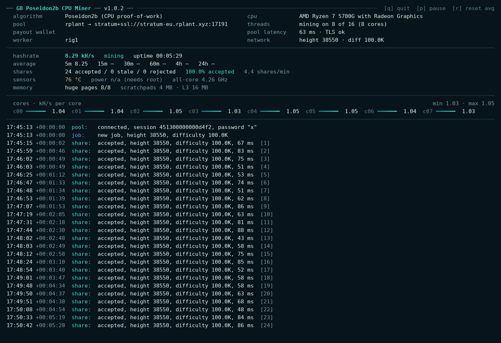
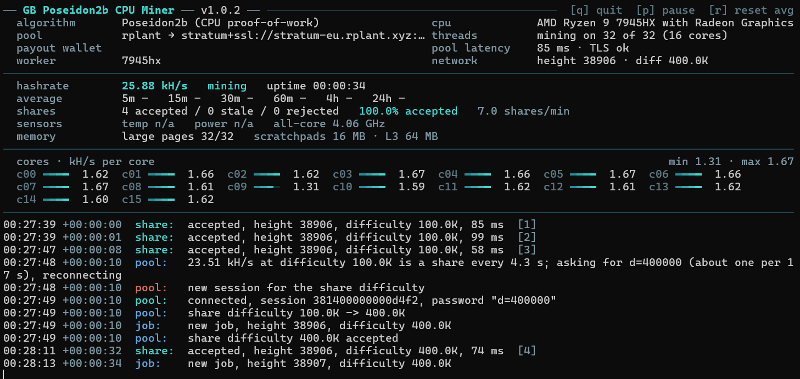

# GB Jetsam CPU Miner

**GB Jetsam CPU Miner** is a CPU miner for **Jetsam (JTM)** and its TowerWalk proof of work. It mines on Stratum pools (rplant and any other JetsamStratum pool) and on HTTP pools (dongqn and any other node-RPC style pool), picks a good profile for your CPU on its own, and runs on Linux, Windows and HiveOS — one download per platform.

**Current release: v1.0.0**

<p>
  
  
</p>
<p><sub>The live view on Linux (left) and in Windows Terminal (right).</sub></p>

---

## Download

Grab the archive for your platform from the [latest release](../../releases/latest), unpack it, and run it from inside the folder.

| Platform | Archive |
|---|---|
| Linux | `gb-jetsam-cpu-miner-1.0.0-linux.tar.gz` |
| Windows | `gb-jetsam-cpu-miner-1.0.0-windows.zip` |
| HiveOS | `gb-jetsam-cpu-miner-1.0.0.tar.gz` (custom-miner package) |

The Linux and Windows archives carry a `SHA256SUMS` with the SHA-256 of each file inside, and the `SHA256SUMS` on the release lists the archives themselves.

Runs on any 64-bit x86 CPU with SSE4.1 and PCLMULQDQ — practically every x86-64 CPU of the last decade; AVX2 and VPCLMULQDQ are used where the CPU has them. The Linux and HiveOS binary needs glibc 2.17 or newer, so it runs on virtually any Linux and on all current HiveOS images.

## Quick start

**Linux** — put your address, pool and worker name at the top of `start.sh`, then:
```
sh start.sh
```
or start the miner directly:
```
./gb-jetsam-cpu-miner --pool rplant --coinbase <your-j1-address> --worker-name rig1
```

**Windows** — put your address, pool and worker name at the top of `start.bat` and double-click it, or:
```
gb-jetsam-cpu-miner.exe --pool rplant --coinbase <your-j1-address> --worker-name rig1
```

**HiveOS** — Flight Sheet → Custom miner:
- Miner name: `gb-jetsam-cpu-miner`
- Installation URL: `https://github.com/gustlborg/gb-poseidon2b-cpu-miner/releases/download/v1.0.0/gb-jetsam-cpu-miner-1.0.0.tar.gz`
- Wallet and worker template: `%WAL%.%WORKER_NAME%` (or your `j1…` address)
- Pool URL: `rplant`, `dongqn`, or your own pool URL
- Extra config (optional, one per line): `THREADS=24`, `POOL_DIFF=auto`, `PASS=x`

`--coinbase` is your Jetsam payout address (`j1…`, 60 characters) and also your pool login; the miner checks it before it starts. Without `--worker-name` it derives a stable name from the machine, so several rigs on one wallet stay apart on the pool.

## Pools

`--pool` takes a short name or your own URL — nothing about the pool is hard-coded.

| `--pool` | Pool |
|---|---|
| `rplant` | rplant, Europe — Stratum over TLS |
| `rplant-na` / `rplant-asia` | rplant, North America / Asia |
| `dongqn` | dongqn — HTTP |
| `stratum+tcp://HOST:PORT` / `stratum+ssl://HOST:PORT` | any JetsamStratum pool |
| `http://HOST:PORT` / `https://HOST:PORT` | any HTTP (node-RPC style) pool |

On Stratum pools the miner picks a sensible share difficulty by itself (`--pool-diff` overrides it) and reconnects on its own if a pool session stalls.

## Options

```
--pool URL|NAME        pool to mine on (see above)
--coinbase ADDRESS     your j1… payout address and pool login
--worker-name NAME     name shown on the pool (optional)
--threads N            logical CPUs to use (default: all; -N leaves N free)
--pool-diff auto|off|N share difficulty: auto (default), the pool's, or fixed
--pass OPTIONS         pool password/options (default "x"; e.g. m=solo)
--tune 20              measure the best profile for this CPU, store it, exit
--report-secs N        stats line every N seconds in a log (default 15)
```

`--tune 20` measures the profiles for your CPU for a few minutes, stores the fastest and exits; every later start uses it. Run it directly (`./gb-jetsam-cpu-miner --tune 20`, on Windows `gb-jetsam-cpu-miner.exe --tune 20`), not through `start.sh` / `start.bat` — those restart the miner in a loop.

## Live view

In a terminal the miner pins a live view at the top — hashrate now and averaged over 5 minutes to 24 hours, accepted / stale / rejected shares, CPU temperature, power draw and hashes per watt — while the log of jobs and shares scrolls below. It redraws itself when you resize the window. Written into a log file or under HiveOS it prints plain timestamped lines instead; `GBJETSAM_PLAIN=1` forces those in a terminal too, e.g. to paste the output into a bug report. Package power is read where the system allows it (root on Linux; not on Windows).

## Huge pages / large pages

The miner keeps each worker's scratchpad in huge pages (Linux) or large pages (Windows); without them it runs about 20–25 % slower. The start-up line `huge pages: N/N workers` shows how many got them.

- **Linux** — transparent huge pages must not be disabled: `cat /sys/kernel/mm/transparent_hugepage/enabled` should show `[madvise]` or `[always]`.
- **Windows** — grant your account the **Lock pages in memory** right (`secpol.msc` → Local Policies → User Rights Assignment), then sign out and in again. Windows Home has no `secpol.msc`; the miner then runs on normal pages.

## Developer fee

This miner mines **3 %** of the time to the developer's wallet and **97 %** to yours. The fee runs as a separate, parallel pool connection under the developer's address; your own shares are never redirected, and there is nothing to configure. If you prefer a miner without a fee, the upstream project `towerminer` (Apache-2.0, see NOTICE) has none.

## What's new in 1.0.0

First release.

- Stratum pools (rplant and any JetsamStratum pool) and HTTP pools (dongqn and any node-RPC pool); your own pool URL works too.
- Automatic profile per CPU; `--tune` measures the best one for your machine.
- Automatic share difficulty and a reconnect watchdog on Stratum.
- Automatic per-machine worker names; the payout address is checked before mining.
- Live view in the terminal; plain timestamped lines in logs and on HiveOS.
- Linux (glibc 2.17+), Windows and HiveOS packages.

## License

Based on [towerminer](NOTICE) (Apache-2.0); the TowerWalk proof of work comes from the Jetsam project (Apache-2.0). See [LICENSE](LICENSE) and [NOTICE](NOTICE).
